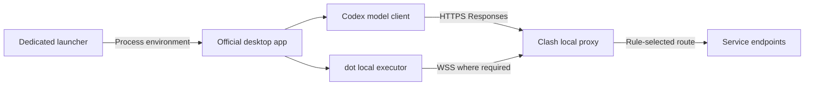

# ChatGPT / Codex & dot · Clash on macOS

**一套可复现的代理配置方法：系统代理开启，TUN 关闭，按通道验证。**  
A reproducible proxy setup: system proxy on, TUN off, verified per connection.


[简体中文](#简体中文) · [English](#english) · [技术配置 / Configuration](#configuration) · [给本地助手的指令 / Agent brief](forchatgpt.md)

## 简体中文

### 这个仓库是做什么的

如果你使用 Clash，浏览器能上网，但 ChatGPT/Codex 仍反复重连，或者 dot 无法操作本机，这份指南提供一条可检查、可撤销的配置路径。

仓库只有两份文档：本页解释方案和使用顺序，[forchatgpt.md](forchatgpt.md) 提供可交给本地助手执行的完整任务指令。**不需要下载或运行本仓库发布的应用包。** 专用入口由助手在你的电脑上根据实际环境生成。

适用前提：一台 Mac、已安装的官方桌面应用、可用的 Clash HTTP/Mixed 代理，以及能够在这台 Mac 上操作的本地助手。本文不提供代理订阅、账号或其他平台的安装脚本。

### 我是怎样走到这套方案的

我最初以为，系统代理开了，应用里的所有连接就会自然经过 Clash。实际情况却是：网页正常，模型仍报 `request timed out`，dot 也可能无法完成本机操作。打开 TUN 后，其他软件又出现了断网或登录异常。

后来我把模型传输和本机连接分开检查：给原版应用传入显式代理，为新的 Codex 聊天配置 HTTPS，然后分别验证模型请求和 dot 的真实本机执行。

| 遇到的现象 | 采取的处理 | 得到的经验 |
| --- | --- | --- |
| 网页正常，应用连接异常 | 核对应用及执行器的代理继承 | 网页可用不能证明每个客户端都采用了代理 |
| 模型 WebSocket 超时 | 配置新聊天使用 HTTPS 并检查日志 | 模型传输可以单独调整与验证 |
| dot 不能操作本机 | 检查显式代理、授权和中继，执行本机查询 | 在线标记和聊天回复不能代替工具执行 |
| TUN 影响其他软件 | 保留系统代理开、TUN 关的基线 | 先稳定所需应用，再另行排查 TUN |

### 技术分析：两项改动，两个通道

系统代理保存在 macOS 网络设置中，程序需要主动采用；专用入口则把代理变量传给本次启动的应用及其子进程。不同网络库支持不同，因此既要检查变量，也要看真实连接。

模型请求另外配置：通过自定义 Codex 提供商设置 `supports_websockets = false`，再验证新聊天使用 `responses_http`。这一设置只控制提供商的 Responses 模型传输。

**dot 本机中继仍可能使用 WebSocket/WSS。我们为它补上代理路径，不把它强制改成 HTTPS。** HTTPS 也会受节点、DNS、规则与出口影响，这不是消除所有超时的通用开关。

下面是验证通过后希望得到的路径；实际分流仍以 Clash 规则和连接日志为准：



### 主路径：检查清楚，再一次准备到位

这条路径把准备工作放在重开应用之前，避免反复切换开关、退出应用或修改同一份配置。遇到前置条件不满足时，先解决该项，再进入下一步。

| 步骤 | 需要做的事 | 进入下一步的条件 |
| --- | --- | --- |
| 1. 确认基础连接 | 安装并登录官方应用；导入自己的 Clash 订阅，验证网页访问 | 代理节点与基础访问可用 |
| 2. 固定配置基线 | 规则模式、系统代理开、TUN 关；记录实际 HTTP/Mixed 端口和应用位置 | 端口、路径、版本均已核实 |
| 3. 交给本地助手 | 发送下方任务，让助手按 `forchatgpt.md` 检查兼容性、备份配置、制作入口 | 无终端入口、候选配置和撤销方法已准备 |
| 4. 集中应用改动 | 合并[模型配置](#configuration)，固定程序坞入口；保存任务，完整退出并从专用入口重开 | 目标应用及执行器获得预期代理参数 |
| 5. 验证模型 | 新建本地 Codex 聊天，完成连续短请求并检查实际传输 | `openai_https`、`responses_http` 与完整回复得到确认 |
| 6. 验证 dot | 授权本机访问，实际查询系统版本，再做间隔复测 | 取得这台 Mac 的工具结果，并记录连接状态 |

可直接发给本地助手：

> 请阅读本仓库的 readme.md 和 forchatgpt.md，按主路径检查并配置这台 Mac。保持 Clash 系统代理开启、TUN 关闭，制作不弹终端的专用启动入口并固定到程序坞。先完成环境检查、备份和准备，再安排一次正常重开，分别验证模型 HTTPS 与 dot 本机执行。不要修改全局登录代理，不要强退我正在使用的应用。

常见混合端口为 `7897`，但必须以本机为准。原版应用可能位于 `/Applications/ChatGPT.app` 或 `/Applications/Codex.app`，也需要核实。使用 HTTP 代理 URL 时，不能填写 SOCKS-only 端口。

### 验收表

| 项目 | 通过标准 | 状态 / 时间 |
| --- | --- | --- |
| 入口 | 点击后打开原版应用，无终端窗口 | 未测 |
| 模型 | 新本地聊天连续 6 次短请求完整结束，核对 `responses_http` 并记录重试 | 未测 |
| dot 首次 | 在这台 Mac 查到系统版本、构建号和 `uname -s` 的工具结果 | 未测 |
| 约 1 分钟后 | 再完成一次相同的本机查询 | 未测 |
| 约 5 分钟后 | 再查一次，记录断连或重连情况 | 未测 |
| Mac 重启后 | 等 Clash 启动，再点专用入口，重新验证模型与 dot | 未测 |

当前官方说明每个 dot 只能同时连接一台个人电脑。迁移时确认连接的是新 Mac，并保持电脑联网、桌面应用打开。

### 结果、边界与撤销

原先的配置验证中，新的模型聊天连续 6 次短请求使用 HTTP 模型传输完成，这 6 次未见模型重试；dot 随后也完成了真实本机查询。这是短时验证结果，不代替你的新电脑验收或长期观察。

日常使用只需：**先开 Clash，再点程序坞的专用入口。** 代理变量只传给这次启动的目标应用及子进程，不等同于 TUN，也不会自动接管 Telegram 等其他软件。

需要撤销时，保存任务、完整退出，再从原版图标打开，可停止由入口注入变量。专用入口及程序坞项目可以移除；模型 HTTPS 配置需单独还原本次字段，保留后来新增的其他设置。

网页也失败时先查节点与分流；模型已走 HTTPS 仍超时时查网络路径；只有 dot 失败时查本机授权、执行器代理和 WSS 中继。不要仅凭相似报错把不同通道归为同一个问题。

## English

### Purpose

This guide is for a Mac where Clash works in the browser, but ChatGPT/Codex keeps reconnecting or dot cannot execute on the local computer.

The repository contains two instruction files: this README explains the approach; [forchatgpt.md](forchatgpt.md) is an execution brief for an assistant with local access. No prebuilt application download is required. The assistant creates a dedicated launcher on your own Mac using its actual app path and proxy port.

Prerequisites: the official desktop app, a working Clash HTTP/Mixed proxy, your own account and subscription, and an assistant able to operate locally. Windows is outside this guide's scope.

### How I arrived here

I initially assumed that enabling the system proxy would cover every connection inside the desktop app. It did not give me consistent results: browser access worked while model requests timed out and dot could not complete local work. Enabling TUN also disrupted other applications in that setup.

I separated the investigation into two parts: explicit proxy configuration for the desktop process and its local executor, and HTTPS transport for new Codex model conversations. Each part needed its own verification.

### Technical approach

A system proxy is a macOS setting that clients must choose to use. A dedicated launcher supplies proxy environment variables to the target process and its children. Support varies by networking library, so inherited variables and actual connections both need checking.

The optional Codex provider configuration disables Responses WebSocket support. Confirm that a newly created local conversation uses `openai_https` and reports `responses_http` in its model transport logs.

**dot's local relay may still use WebSocket/WSS. This approach provides an explicit proxy path; it does not force dot to use HTTPS.** Switching model transport also cannot repair an unreliable proxy node or every DNS and routing problem.

### Primary setup path

Prepare everything before restarting the desktop app. If a prerequisite fails, resolve it before proceeding rather than changing several settings at once.

| Step | Action | Completion condition |
| --- | --- | --- |
| 1. Establish connectivity | Install and sign in to the official apps; import your own Clash subscription; test browser access | Basic proxy connectivity works |
| 2. Record the baseline | Rule mode, system proxy on, TUN off; identify the real HTTP/Mixed port, app path and versions | Inputs are verified |
| 3. Prepare locally | Give the assistant `forchatgpt.md`; check compatibility, back up config and create the launcher | Launcher, candidate config and rollback steps are ready |
| 4. Apply together | Merge the [model config](#configuration), pin the launcher, save work and reopen the app through it | Target processes inherit the intended proxy values |
| 5. Verify models | Create a new local Codex conversation, complete six short requests and inspect transport | `openai_https`, `responses_http` and completed responses are confirmed |
| 6. Verify dot | Allow access to this Mac, perform a real read-only local query and repeat after intervals | Local tool results and connection behavior are recorded |

Copy this task to a local assistant:

> Read this repository's readme.md and forchatgpt.md, then follow the primary path to configure this Mac. Keep Clash's system proxy on and TUN off. Create a dedicated launcher that opens the official app without a Terminal window and pin it to the Dock. Complete checks, backups and preparation before one normal app restart. Verify model HTTPS transport and dot's actual local execution separately. Do not set a global login proxy or force-quit active work.

Use the actual port; `7897` is only a common default. Verify whether the official app is installed as `/Applications/ChatGPT.app`, `/Applications/Codex.app`, or elsewhere. An HTTP proxy URL must point to an HTTP/Mixed port, not a SOCKS-only listener.

### Acceptance and daily use

Check the launcher, six completed model requests with verified transport, and a real dot tool call on this Mac. Repeat the local query after roughly one and five minutes; record interruptions. After an intentional Mac restart, wait for Clash, open the dedicated launcher and retest. Mark unperformed checks as untested.

A useful dot test is: “On the Mac I just connected, read the macOS version, build number and `uname -s`. Report the actual local tool results. Do not read or modify my personal files or substitute a cloud computer.” The current official guide allows one connected personal computer per dot; keep the intended Mac online with the app open.

The original setup completed six short model requests using HTTP transport without model retries during those requests, followed by a successful real local query through dot. This was a short validation, not evidence of long-term reliability or compatibility with every version and network.

For daily use: start Clash, then click the dedicated Dock launcher. To undo the launcher environment, quit normally and reopen the original app. Remove the launcher and its Dock item if desired. Restore the model provider settings separately, preserving unrelated later changes.

## Configuration

### Model transport / 模型传输

Back up `~/.codex/config.toml` before editing; preserve the existing model and unrelated settings. Put this root key **before the first TOML table** and replace any existing value rather than duplicating it.  
编辑前备份，保留原模型及其他设置。顶层键放在第一个 TOML 表之前，已有键时替换。

```toml
model_provider = "openai_https"
```

Append or update this provider table. Do not override the reserved built-in `openai` provider.  
在末尾添加或更新同名表，不覆盖内置 `openai` 提供商。

```toml
[model_providers.openai_https]
name = "OpenAI HTTPS"
requires_openai_auth = true
wire_api = "responses"
supports_websockets = false
```

Keep the existing OpenAI sign-in method; do not add a third-party `base_url`. Restart through the dedicated launcher and create a **new local Codex conversation**. Existing conversations may retain their original provider.  
保持原有 OpenAI 登录方式，不添加第三方地址。重开后新建本地聊天，核对实际传输。

The launcher environment, implementation requirements and verification procedure are specified in [forchatgpt.md](forchatgpt.md).  
入口所需环境变量、实现要求与验收步骤见同仓库指令文件。

## Compatibility & references / 兼容性与参考

The provider setup was validated with Codex CLI `0.163.0-alpha.10.2`. Recheck current documentation and runtime behavior after updates. This is a community guide, not an official OpenAI or Clash solution.  
配置曾在上述版本验证；更新后重新核对文档和运行结果。本项目是社区使用指南。

- [Clash Verge: Quick start / 快速入门](https://www.clashverge.dev/guide/quickstart.html)
- [OpenAI: Configuration reference / 配置参考](https://learn.chatgpt.com/docs/config-file/config-reference)
- [OpenAI: Computers and dot / 本机连接](https://learn.chatgpt.com/docs/dots/computers-and-apps)
